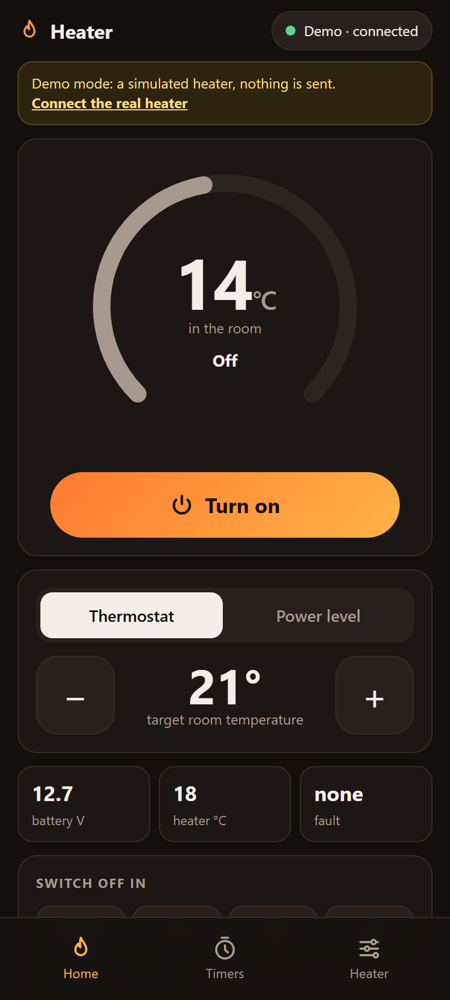
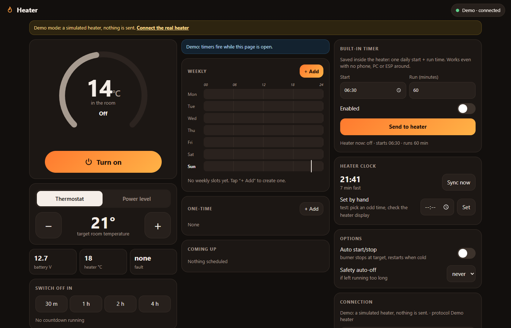

# Diesel Heater BLE

Turn your Chinese diesel heater (Vevor, BYD and other heaters that use the **AirHeaterBLE** app) on and off from your phone's
browser over Bluetooth. You don't need to install an app, run a server or use a cloud account: open the page, connect, and tap **Turn on**.

**Open the app: https://zenfortv.github.io/diesel-heater-ble/** · **Android app (timers + smart thermostat with the
screen off): [download the APK from Releases](../../releases/latest)**

> [!WARNING]
> A diesel heater burns fuel inside your vehicle. This is an **unofficial, free, open-source** hobby project
> provided **as is, without any warranty**. Remote control and automatic starts add risk: fire, carbon monoxide,
> loss of the vehicle, injury or death. **You use it entirely at your own risk** and you must accept the
> [terms of use and safety disclaimer](web/DISCLAIMER.md) before using it (the app and the page ask for it).
> The authors, contributors and **the publisher** (GitHub "zenfortv") take no responsibility for any damage. Read the [safety checklist](#safety-checklist) first.

<p>
  
  &nbsp;
  
</p>

*(screenshots from the built-in demo mode)*

## How to use it
1. On an **Android phone, open the link above in Chrome**. iPhone Safari has no Web Bluetooth, so it won't work there.
2. Chrome menu ⋮ → **Add to Home screen**. From then on it opens like a normal app, and it also works offline.
3. Switch the heater on at the mains and **close the AirHeaterBLE app**. The heater accepts only one Bluetooth connection at a time.
4. Tap **Connect via Bluetooth** and pick your heater from the list (named like `BYD-…`).
5. Tap **Turn on**. Use the thermostat (8–36 °C) or the power level (1–10), and **Switch off in** 30 min / 1 h / 2 h / 4 h.

Each morning: open the home-screen icon, tap Connect, then tap Turn on. That takes about 5 seconds, and you need to be within Bluetooth range (~10 m).

Not sure yet? Tap **Try the demo**. It runs a simulated heater and sends nothing.

### What the tabs do
- **Home**: power, thermostat or power level, room and heater temperature, battery voltage, faults explained in plain words.
- **Timers**: weekly on/off slots and one-time timers. In direct Bluetooth mode these only run *while the page is open*.
- **Heater**: the heater's **built-in daily timer** (start time + run minutes). It is stored inside the heater, so it fires with no phone around (still being tested, see below). Also the heater clock, auto start/stop and safety auto-off.

### Change the heater's Bluetooth password (default 1234)
Anyone nearby with the app can control a heater that still uses 1234. To change it:
1. Connect, then **Heater** tab → **Change heater password**, and type 4 new digits → **Next**.
2. On the heater's panel, with the heater switched off: open the **engineering mode**, go to the Bluetooth password item
   (**En09**, or **010** on some panels), and **keep the gear button pressed** until the number on the panel changes to your new PIN.
3. The panel shows **SUC**. Tap **The panel showed SUC** in the app. Done.

If it doesn't work, tap **go back** and the app returns to the old password. Nothing changes on the heater until the panel shows SUC.
Tested on the colour "AirHeater Controller" panel. The official AirHeaterBLE app also needs the new password afterwards
(Setup → Password).

### Limits
- The phone only controls the heater while it's within Bluetooth range.
- In the browser, the weekly timers only fire while the page stays open and the screen is on (use **Night mode** with the phone on the charger).
  The **Android app** below keeps the heater connected in the background, so timers work with the screen off.
- The built-in timer and clock commands (10–13) come from the official app's code and are **not yet confirmed** on a real heater.

### Android app (timers with the screen off)
`android/` builds a small app (`DieselHeater.apk`, Android 8+) that shows the same page but keeps the Bluetooth
link in a background service: a permanent notification shows the heater state and the next timer, timers fire
with the phone locked, and it starts again after a reboot. On first start allow "Nearby devices" and notifications,
say **Allow** to "ignore battery optimisation", then pick your heater (BYD-…). Some brands (Xiaomi, Huawei, Samsung)
also need the app set to "No restrictions" in its battery settings. Build: `sh android/build.sh`.

**Auto thermostat** (app only, switch on Home, settings in the Heater tab): the heater's own thermostat mode only
lowers the power near the target and keeps burning. The Auto thermostat switches the burner fully off above the
target and back on below it, reading the room sensor (it keeps working with the burner off). While it is on, nothing
else switches the heater: the power button, timers, countdown, safety auto-off, the built-in timer and the heater's own
auto start/stop are locked. Switching it off leaves a running heater running (manual control from then on). Stopping the heater on its panel switches it off too.
The notification shows the degrees to go or the time to the next timer, and every start/stop is notified.

## Safety checklist
Do this before trusting any automatic function, and again after every update or change to the heater:
1. A **carbon-monoxide alarm** and a **smoke alarm** are fitted near where you sleep and tested. A fire extinguisher is at hand.
2. The heater, exhaust, fuel line and wiring are installed per the manufacturer's manual and checked for leaks.
3. With you present: **Turn on** and **Turn off** from the app work, every time.
4. Set a one-time timer 3 minutes ahead, lock the phone, and watch it start. Same for a timer that switches it off.
5. Smart thermostat: compare the room reading with a separate thermometer and set the **sensor correction**;
   then watch one full cycle (start below the target, stop above it after the minimum run).
6. Close the fuel tap (or unplug the pump) and start: after the start fails **twice**, the app must stop trying and
   show an alert. Open the tap again and switch the thermostat back on.
7. Walk out of Bluetooth range while it runs: after about 2 minutes you get an alert, and the heater **keeps running**
   on its own. Know how to stop it from its panel or by cutting its power.

Built-in protections of the smart thermostat (unit-tested in `android/app/src/test`, `sh android/build.sh testReleaseUnitTest`):
minimum run and rest times, at most 3 starts per hour, no more automatic starts after 2 that didn't light (kept across
restarts), no start under the battery limit or with a heater fault, stop above 35 °C room or on an impossible sensor
reading, nothing done on missing or old data, alerts when the heater can't be switched off or is lost while running.
These are conveniences, **not** safety devices.

## License
[MIT](LICENSE): free to use, copy and change, **without warranty**. Use is also subject to the
[terms of use and safety disclaimer](web/DISCLAIMER.md).

## Feedback and forks
Found a bug or have an idea? Open an [Issue](../../issues). The original repo is maintained by its author only and
pull requests are off, but **forks are welcome**: see [CONTRIBUTING.md](CONTRIBUTING.md).

---

# Technical details

Control an AirHeaterBLE diesel heater (Vevor / BYD / generic Chinese) from the phone and laptop, with the
on/off timers the official app lacks and automatic correction of the heater's drifting clock.

## The app (`web/index.html`)
One self-contained page, installable as an app on Android ("Add to Home screen"). It picks its mode by itself:

| Mode | When | Timers | Clock fix |
|---|---|---|---|
| **Box** | page opened from the ESP32 box / PC server (`http://<box>:8770`) | weekly, one-time, countdown, 24/7 | automatic, hourly |
| **Direct Bluetooth** | page opened from GitHub Pages in Chrome (Android) -> "Connect via Bluetooth" | only while the page is open + the heater's built-in timer | when the page is open |
| **Demo** | "Try the demo" | simulated | simulated |

Tabs: **Home** (power, thermostat / power level, room temp, faults in plain words, "switch off in"),
**Timers** (week chart, weekly slots incl. past midnight, one-time timers, coming up),
**Heater** (built-in timer, heater clock + drift, auto start/stop, safety auto-off, connection, history).
On a wide screen the three tabs show side by side.

Web Bluetooth needs `https://` (GitHub Pages) or `localhost`. The page's protocol code is checked against
the Python one by `tests/test_web_protocol.py`.

```
phone / laptop ──Wi-Fi──► ESP32 box or PC (server.py :8770) ──BLE──► heater      (Box mode)
phone (Chrome) ─────────────────────────────────────────────BLE──► heater      (Direct mode)
```

## Run the PC server
```
.venv\Scripts\python.exe scan.py          # find the heater address (close the phone app first!)
.venv\Scripts\python.exe probe.py <addr>  # read-only test: connects and asks for status only
# edit config.json: "address": "XX:XX:...", "simulate": false
.venv\Scripts\python.exe server.py        # prints http://<pc-ip>:8770
```
With `"simulate": true` (default) a fake heater is used, so you can try the app without hardware.

**Known issue (2026-10-24):** this PC (Windows, Realtek Bluetooth) opens the radio link to the heater
`BYD-988917049E28` but the heater never answers Windows' GATT service discovery (bleak and raw WinRT both time
out). Phone (Android) and ESP32 stacks work with these modules, so use Direct mode or the ESP32 box.

## Features
- power, thermostat (8-36 °C) or level (1-10), live status (room/heater temp, battery, errors)
- weekly slots (days + on/off time + temp/level), past midnight allowed
- one-time timers, "switch off in" countdown, safety auto-off after N hours
- the heater's own built-in daily timer (start + run minutes), runs with the PC off
- automatic clock correction: the heater's clock drifts (fast or slow), so the server re-sets it (cmd 10)
  on connect and every `clock_sync_minutes` (config, default 60). Heaters that report their clock
  (encrypted variants) are only corrected when off by >= 1 min, and the drift in min/day is shown.
- auto start/stop toggle (only on newer, encrypted-protocol heaters)
- "Release Bluetooth" switch: the heater allows ONE connection at a time; release it to use AirHeaterBLE

## Protocol (sources)
- warehog/esphome-diesel-heater-ble - decompiled AirHeaterBLE JS; 4 variants AA55/AA66 (+ XOR "password" encrypted)
- iotmaestro/vevor-heater-ble - command table; spin877/Bruciatore_BLE - sniffed from the app
- Spettacolo83/diesel-heater-ble (pip lib, used for parsing)

Command: `AA 55 <pin/100> <pin%100> <cmd> <data lo> <data hi> <sum of bytes 2-6>` on FFE0/FFE1
(PIN 1234 -> `0C 22`). Verified against the AirHeaterBLE APK itself
(`assets/apps/__UNI__9A3735B/www/app-service.js`, `common/bluetooth/useBluetooth.js` packet builder).

Command numbers are DECIMAL (warehog's table prints them with a wrong `0x` prefix):

| cmd | meaning | data |
|----|----|----|
| 1 | status poll | 0 |
| 2 | mode | 1 level, 2 thermostat |
| 3 | power | 0/1 |
| 4 | level or target temp | 1-10 / 8-36 |
| 10 | set heater clock | minutes since midnight |
| 11 | built-in timer start | minutes since midnight |
| 12 | built-in timer run time | minutes |
| 13 | built-in timer enable | 0/1 |
| 14 | language | |
| 15 | temperature unit | |
| 16 | tank volume (also "bluetooth on/off" 20/21 on some pages) | |
| 17 | oil pump type / 433 MHz remote on/off (20/21) | |
| 18 | auto start/stop ("i_stop") | 0/1 |
| 19 | altitude unit | |
| 20 | temperature offset | signed |
| 21 | backlight | |

Readback of clock/timer (bytes 19-25 of the decrypted frame) only exists on the 48-byte encrypted variants.
The newest app also has a multi-slot weekly timer, but only over the separate "V2.1" protocol (header `FE AA`).

## Remote access later
- Easiest: install Tailscale on the room PC and the phone -> open `http://<pc-tailscale-name>:8770` from anywhere.
  `tailscale serve 8770` gives HTTPS, which also allows a full app install on Android.
- If you expose it any other way, set `"token"` in config.json first.
- Cheaper always-on alternative to a PC: ESP32 (~5 EUR) with warehog's ESPHome component + Home Assistant.

## Publishing
`.github/workflows/pages.yml` publishes `web/` to GitHub Pages on every push to `main`
(one-time: repo Settings -> Pages -> Source "GitHub Actions"). `config.json` and `schedules.json` stay local.

## Notes
- Windows firewall must allow Python on port 8770 for the phone to reach it.
- Commands 10-13 (clock + built-in timer) come from the AirHeaterBLE app code but are not yet confirmed on the real heater.
